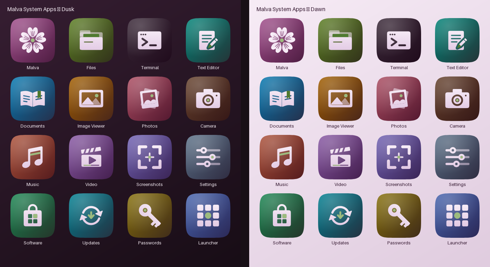
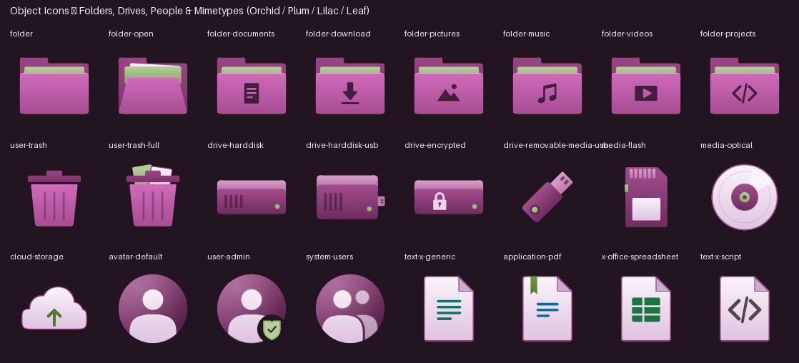
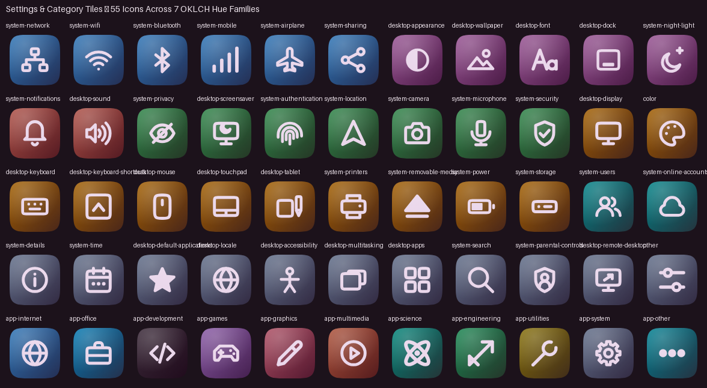
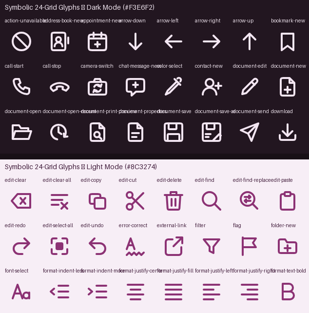

# malva-icons

The [Malva OS](https://github.com/orgs/Malvaos/repositories) freedesktop icon theme (`Malva`): a pure-SVG icon theme where every icon is a single scalable vector drawing, paired with its deterministic Python generator pipeline, optical-centring engine, on-demand PNG rasteriser, and automated pixel verification suite.









## Features

* **Pure SVG freedesktop theme (`assets/icons/Malva/`).** 613 SVG files (701,188 bytes total; 275 KB gzipped) plus `index.theme` and `manifest.json`. Zero pre-baked PNGs are shipped in the repository tree; one SVG serves every size, and `tools/icons/export_png.py` rasterises any icon or the entire theme on demand.
* **758 freedesktop names covered.** 613 canonical SVG drawings and 145 standard freedesktop aliases (`inode-directory` -> `folder`, optical media variants -> `media-optical`, GNOME/GTK action and status names) recorded in `manifest.json` with SHA-256 digests and materialised as relative symlinks (or copies with `--copy`) at install time.
* **Four brand materials & Balance-dial geometry.** Full-colour icons are built from four Malva brand materials (`orchid` for containers, `plum` for hardware and people, `lilac` for paper and glyphs, and `leaf` green for the single brand accent per icon). Object corners follow the Malva Balance-dial superellipse (`n = 4.0` from `crates/malva-tokens/src/balance.rs`), while app and category tiles use the `n = 5.0` squircle.
* **Measured optical centring (`tools/icons/optical.py`).** Every icon family places its bounding box on the canvas centre with a capped 1 % pull toward its opacity-weighted centre of mass (`glyph_shifts.json`, `tile_shifts.json`, `object_shifts.json`, `emblem_shifts.json`, `kit_shifts.json`).
* **Self-contained SVG hygiene.** No `<text>`, `<image>`, `<script>`, `<style>`, `<filter>`, `<use>`, or external links appear in any of the 613 SVG files. Every element ID is prefixed with its icon ID (`567` unique IDs across the theme) so any number of SVGs can be inlined into the same document without collision.
* **End-to-end verification with negative tests.** Five domain check suites (`check_glyphs.py`, `check_apps.py`, `check_objects.py`, `check_tiles.py`, `check_theme.py`) and geometry self-tests (`selftest.py`) verify pixel contrast (WCAG 1.4.11 >= 3:1), CVD separability (protanopia, deuteranopia, tritanopia), optical centring, GTK3 icon lookup, and `librsvg` vs. Chromium cross-engine rendering.

## What is in the theme

| Directory | Files | Description |
| :--- | ---: | :--- |
| `scalable/apps` | 16 | System app icons on exponent-5 squircle tiles (`malva`, `files`, `terminal`, `text-editor`, `document-viewer`, `image-viewer`, `photos`, `camera`, `music`, `video`, `screenshot`, `settings`, `app-store`, `updater`, `passwords`, `launcher`) |
| `scalable/categories` | 55 | Settings-pane and application-category tiles across 7 OKLCH hue groups |
| `scalable/places` | 18 | Folders (`folder`, `folder-open`, `folder-documents`, `folder-downloads`, `folder-pictures`, `folder-music`, `folder-videos`, `folder-projects`, `folder-locked`, `user-home`, `user-desktop`, `folder-publicshare`) and trash states (`user-trash`, `user-trash-full`) |
| `scalable/devices` | 8 | Internal, external, encrypted, and network storage drives, USB stick, SD flash media, optical disc, and cloud storage |
| `scalable/mimetypes` | 26 | Document pages with colour-coded OKLCH emblems (generic, text, office document, PDF, spreadsheet, presentation, image, audio, video, archive, code/script, and package formats) |
| `scalable/status` | 12 | User, administrator, guest, system-users group, ID card, and numbered vector avatar discs (`avatar-2` to `avatar-8`) |
| `symbolic/actions`, `symbolic/status` | 157, 157 | One-colour (`currentColor`) 24-grid glyphs for toolbars, menus, and panel indicators (including 34 `-rtl` mirrored variants) |
| `symbolic/devices`, `apps`, `mimetypes`, `places`, `categories`, `ui`, `emblems`, `legacy` | 44, 35, 26, 17, 17, 19, 5, 1 | Remaining 24-grid symbolic glyphs plus fitted `currentColor` symbolic cuts of apps, objects, and category tiles |

### Brand materials

| Material | Role | Hex stops |
| :--- | :--- | :--- |
| **Orchid** | Containers (folders, trash bins) | `#D06BBA` -> `#A64C93` (front); `#9A4585` -> `#7C3369` (back); `#3A1232` (engraved ink) |
| **Plum** | Hardware, people & brand app tile | `#A24E8C` -> `#4E1D42` (tile); `#6F2B5F` (body); `#D99FCB` (lid) |
| **Lilac** | Paper sheets & app glyphs | `#FBF3FA` -> `#DEC3E0` (surface); `#8C3274` (page edge); `#CDAACF` (folded corner) |
| **Leaf** | Single brand accent per icon | `#9DBB7E` (on tile); `#B4CF98` -> `#8FB06D` (sheet/LED); `#4F7A2F` (on lilac paper) |

## Install

Install the theme for the current user (`~/.local/share/icons/Malva`) or system-wide (`/usr/share/icons/Malva`):

```bash
# Current user (~/.local/share/icons/Malva)
python3 tools/icons/install_theme.py

# System-wide (/usr/share/icons/Malva)
sudo python3 tools/icons/install_theme.py --system

# Custom target directory, using file copies instead of symlinks (for FAT32 / shared storage)
python3 tools/icons/install_theme.py --dest /path/to/icons --copy

# Uninstall
python3 tools/icons/install_theme.py --uninstall
```

Or use the top-level `Makefile`:

```bash
make install
make uninstall
```

To activate the theme on GNOME / GTK desktops:

```bash
gsettings set org.gnome.desktop.interface icon-theme 'Malva'
```

## Build and export

### Rebuild the SVG theme

```bash
# Rebuild assets/icons/Malva/ and assets/icons/malva-app-format/
python3 tools/icons/build_theme.py

# Include optional heavier 16-32 px drawings (small/<context>/<name>.svg)
python3 tools/icons/build_theme.py --small-cuts

# Build into a custom directory with relative alias symlinks materialised
python3 tools/icons/build_theme.py --out build/Malva --aliases symlink
```

### Export PNGs on demand

The repository ships pure SVGs. When an application or packaging target needs raster PNGs at specific pixel sizes:

```bash
# Export one or more icons at multiple sizes
python3 tools/icons/export_png.py assets/icons/Malva/scalable/apps/files.svg --size 64 128 256 -o out/

# Export a one-colour symbolic glyph in a custom colour
python3 tools/icons/export_png.py assets/icons/Malva/symbolic/status/battery-level-50-symbolic.svg --size 24 --color "#F3E6F2" -o out/

# Export the entire theme as a classic multi-size raster tree (including aliases)
python3 tools/icons/export_png.py --theme assets/icons/Malva --size 16 24 32 48 64 128 256 --color "#2E2230" -o out/ --aliases
```

`export_png.py` automatically selects `rsvg-convert`, `resvg`, `inkscape`, `librsvg` (`libcairo.so.2` + `librsvg-2.so.2`), or headless Chromium.

## Verify and run checks

Run the automated test suite and pixel/geometry checks:

```bash
# Run the repository unit and integration test suite
python3 -m unittest discover -s tests -v

# Geometry, OKLCH gamut mapping, CIEDE2000, and CVD matrix self-tests
python3 tools/icons/selftest.py

# Full theme verification (tree hygiene, SHA-256 manifest, deterministic rebuild, GTK3 lookup, librsvg vs Chromium)
python3 tools/icons/check_theme.py

# Family-specific pixel checks and negative test suites
python3 tools/icons/check_glyphs.py
python3 tools/icons/check_apps.py
python3 tools/icons/check_objects.py
python3 tools/icons/check_tiles.py
```

## Layout

```text
malva-icons/
├── assets/
│   ├── brand/                        # Reference brand mark SVG and dusk/dawn test wallpapers
│   └── icons/
│       ├── Malva/                    # Shipped freedesktop SVG icon theme (613 SVGs, index.theme, manifest.json)
│       │   ├── scalable/             # Full-colour 1024-canvas icons (apps, categories, devices, mimetypes, places, status)
│       │   └── symbolic/             # One-colour currentColor icons (actions, apps, categories, devices, emblems, legacy, mimetypes, places, status, ui)
│       └── malva-app-format/         # App-format Malva brand logo in plum, lilac, dusk, leaf, mono, and small cuts
├── crates/
│   └── malva-tokens/                 # Rust crate defining Balance-dial CORNER_EXPONENT (4.0)
├── docs/
│   └── icons/                        # Design and measurement notes (ICON_THEME.md, CENTRING.md, OBJECT_ICONS.md, MUSIC_ICON.md)
├── packaging/                        # Distro packaging (Arch PKGBUILD, Meson build, POSIX install.sh)
├── preview/                          # Rendered showcase sheets for apps, objects, tiles, and symbolic glyphs
├── tests/                            # Automated unit and integration test suite
├── tokens/
│   └── tokens.toml                   # Malva brand colour seeds and geometry tokens
├── tools/
│   └── icons/                        # Python generator modules, optical centring, PNG exporter, installer, and check suites
├── CHANGELOG.md
├── Makefile
└── README.md
```

## Detailed documentation

* [`docs/icons/ICON_THEME.md`](docs/icons/ICON_THEME.md) — Theme overview, directory breakdown, and manifest format.
* [`docs/icons/CENTRING.md`](docs/icons/CENTRING.md) — Optical centring rule (`optical.py`) and before/after measurements across all icon families.
* [`docs/icons/OBJECT_ICONS.md`](docs/icons/OBJECT_ICONS.md) — Material palette, Balance-dial superellipse corners, and shared pictogram vocabulary for folders, drives, people, and files.
* [`docs/icons/MUSIC_ICON.md`](docs/icons/MUSIC_ICON.md) — Geometric construction and fillet verification for the Music app icon.

## Known limits

* **GTK symbolic recolouring.** GTK recolours `-symbolic` icons by injecting a CSS rule that sets `fill` on every shape (`rect, circle, path { fill: ... !important }`). Because most of the 24-grid symbolic glyphs are 2-unit stroke drawings, setting `fill` alters their shape under GTK's recolouring rule (affecting 325 of 409 glyph files, 6 of 15 app cuts, 16 of 53 object cuts, and 1 tile cut). Environments that render the SVG as authored (Slint, Qt, browsers, and Malva OS apps) draw them accurately. Converting stroked paths to filled outlines is planned next.
* **Text Editor symbolic cut.** `text-editor-symbolic` is served by the glyph kit's document glyph rather than a separate app-specific silhouette.
* **16 px stroke crispness.** A 24-grid glyph uses 2 px strokes on whole pixels at 24 px, which scale to 1.33 px at 16 px. Passing `--small-cuts` to `build_theme.py` generates heavier dedicated 16-32 px drawings for app and object icons.
* **Numbered avatars.** `avatar-2` through `avatar-8` are colour portraits and intentionally omit `-symbolic` cuts.
